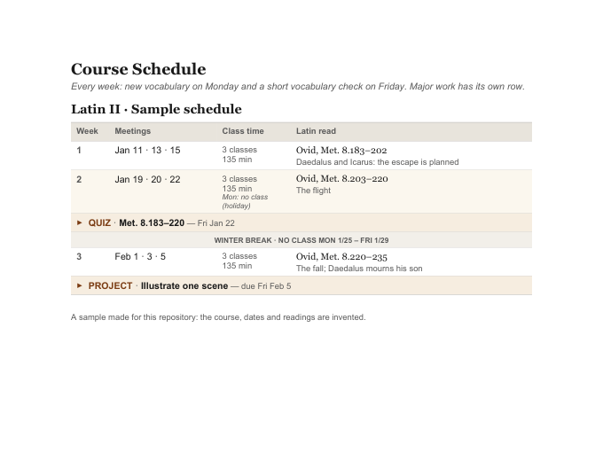
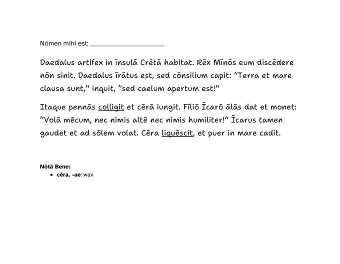
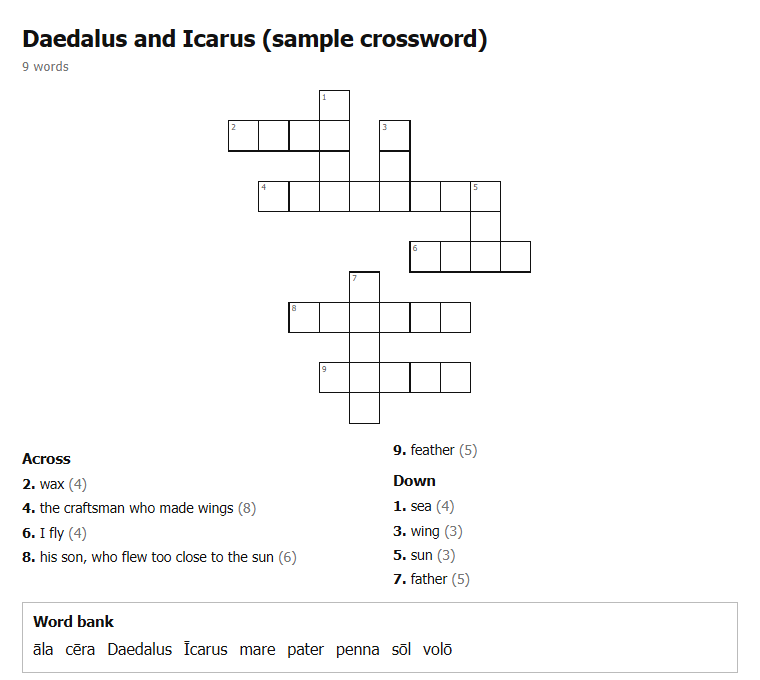

# Renderers: JSON in, documents out

Three Node scripts that turn a JSON file into a document for students. Each JSON shape is
shown by a working example in [`examples/`](examples/). Copy one and change it.

```bash
npm install
node schedule_docx.js examples/schedule.json schedule.docx
node swyk_docx.js     examples/swyk.json     quiz.docx
node crossword.js     examples/crossword.json crossword.html
```

  

| script | makes | notes |
|---|---|---|
| `schedule_docx.js` | a course schedule as a Word table: one row per stretch of classes, with its dates, time, reading and support, plus full-width rows for major work and breaks | dates are `YYYY-MM-DD`; a stretch with `"short": true` is shaded |
| `swyk_docx.js` | a "Show What You Know" reading quiz as a Word file: the story (new words underlined, optional glosses), then key words, guessing from context, main idea, an inferential question, a self-assessment rubric, an honor statement and feedback questions | the rubric has five levels, and every row needs a cell for each; in `main`, a `mark` starting "Underline", "Circle", "Draw a box" or "Draw a squiggly line" is drawn that way |
| `crossword.js` | a printable crossword (HTML), and a fillable version students can type into | answers keep their macrons. `long_vowels` lists the letters that count as long, and `bare` is the answer without them. The layout is seeded, so the same JSON always gives the same puzzle |

The Word files use Georgia and Arial, which Google Docs, Word and ONLYOFFICE all have, so a file
opens looking the same in each. The crossword puts its interactive part, a copy of
[Exolve](https://github.com/viresh-ratnakar/exolve) (MIT licence, in `vendor/`), inside every file
it writes, so the puzzle works offline.
