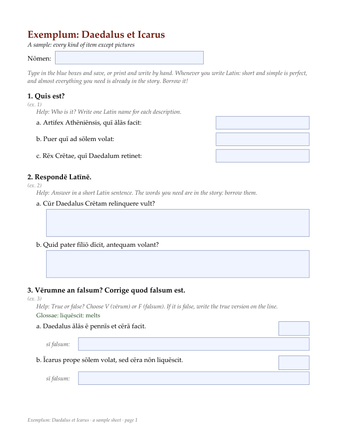

# Worksheets

`worksheet.py` turns a JSON file of exercises into fillable, printable PDF worksheets, one per
sheet you define. A student can type into the boxes and save the file, or print it and write by
hand. Both work, because every answer space is sized for handwriting first.



```bash
pip install -r ../requirements.txt
python worksheet.py --data example --out built
```

That builds `built/Exemplum - Daedalus et Icarus.pdf` from [`example/packets_data.json`](example/packets_data.json),
then audits it. Open the example next to the PDF: it uses every kind of item.

## The print-size audit

Every build ends with an audit of the PDFs it wrote, against these rules:

- body text at least 12 pt; help and glosses at least 11 pt;
- a handwritten answer line at least 24 pt tall (wide-ruled paper), and two lines for a sentence;
- a one-word answer at least 2.25 inches wide; a letter box at least 24 × 24 pt; a checkbox at least 14 pt;
- no exercise heading, and no question, split from its answer space by a page break.

## Writing your own

Copy `example/`, then edit its `packets_data.json`. Each entry of `"W"` is one sheet:
`[title, span, dates, [exercise, ...]]`. Each exercise has a `ref`, an instruction (`instr`),
its `items`, and optionally a word `box` and a `note`. The item kinds:

| kind | looks like |
|---|---|
| `["short", text]` | a question with a short answer box at the right |
| `["q", text]` | a question with two lines for a sentence |
| `["cloze", "text with ___ gaps"]` | numbered answer boxes, one per gap |
| `["vf", statement]` | a vērum/falsum choice and a line to correct it |
| `["order", text]` | a box for a number, to put events in order |
| `["match", [beginnings], [endings]]` | a letter box beside each ending |
| `["choice", stem, [options]]` | a checkbox per option |
| `["table", [left], [right]]` | "idem (=)" and "contrārium (≠)" columns |
| `["image", "<scan>_<page>.png", [boxes], mode]` | pictures cropped from a scanned PDF named in `"SOURCES"` |

`"HELP"` (an English line under an instruction) and `"GLOSS"` (glosses for words in the
questions) are keyed by the exercise's `ref`. The docstring at the top of `worksheet.py`
lists the remaining settings: the subtitle, the intro line, the scans, the fonts.

**Fonts.** The default is Palatino Linotype, at its Windows path. On another system, pass
`--font-regular`, `--font-bold` and `--font-italic` with TTF files that include the macron vowels
(ā ē ī ō ū ȳ). PDF's built-in fonts do not include them.
